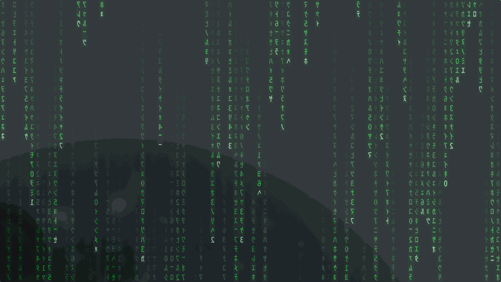
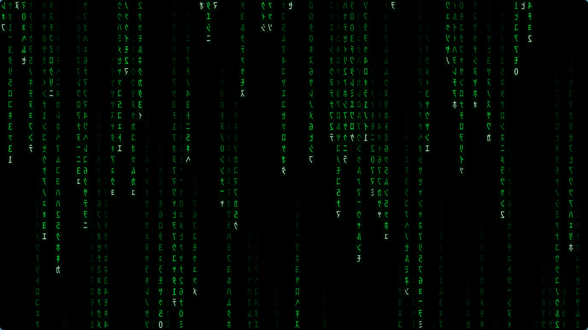

# Matrix Wallpaper

Something I've always wanted to have on my desktop as a wallpaper.  Animated, moving
matrix rain that mirrors the totally epic movie.  I used claude to help me get this
setup for my system. I am sure there are many of you out there much more experienced
than me, and smarter too, who can pull and update even better features!  Have fun.

An animated **Matrix digital-rain** wallpaper for wlroots Wayland compositors
(Hyprland, Sway, river, …). A single self-contained GLSL shader renders the real
film glyph set — mirrored half-width katakana and digits — cascading down your
screen, drawn live by [`mpvpaper`](https://github.com/GhostNaN/mpvpaper).



The glyphs are **baked into the shader** as a bit-packed coverage atlas, so there
are no external textures, no font dependency at runtime, and nothing to install
besides `mpv` and `mpvpaper`.



---

## Features

- **Authentic glyphs** — mirrored half-width katakana + digits, the actual
  Matrix character set, not a procedural dot-matrix fake.
- **Smooth & crisp** — glyphs are stored with 4-bit (16-level) anti-aliased
  coverage and bilinearly sampled, so edges stay clean even on 6K panels.
- **Self-contained** — the atlas is embedded as `const uint` data in the shader;
  no `//!TEXTURE` blocks (which fail to link on some NVIDIA/mpv combos), no font
  needed to run.
- **Tunable** — rain density, trail length, speed, and colors are `#define`s at
  the top of `matrix.glsl`.
- **Regenerable** — `gen-atlas.py` re-bakes the atlas from any mono CJK font.

---

## Requirements

| Component | Purpose | Fedora 44 package |
|-----------|---------|-------------------|
| A wlroots compositor | provides `wlr-layer-shell` (Hyprland/Sway/river) | — |
| `mpv` (libmpv) | renders the shader | `mpv` |
| `mpvpaper` | puts the render on the wallpaper layer | build from source (below) |
| Python 3 + Pillow | *only* to regenerate the atlas | `python3-pillow` |
| Noto Sans Mono CJK | *only* to regenerate the atlas | `google-noto-sans-mono-cjk-vf-fonts` |

> **Note:** GNOME and KDE Plasma do **not** implement `wlr-layer-shell`, so
> `mpvpaper` will not work there. This is for wlroots-based compositors.

---

## Install (Fedora 44)

### 1. Install mpv

```bash
sudo dnf install mpv
```

### 2. Build mpvpaper

`mpvpaper` is not in the Fedora repositories, so build it from source:

```bash
sudo dnf install git meson ninja-build gcc pkgconf-pkg-config \
                 mpv-libs-devel wayland-devel wayland-protocols-devel \
                 mesa-libEGL-devel mesa-libGL-devel

git clone https://github.com/GhostNaN/mpvpaper
cd mpvpaper
meson setup build --prefix="$HOME/.local"   # installs to ~/.local/bin
ninja -C build
ninja -C build install
```

Make sure `~/.local/bin` is on your `PATH` (the launcher script adds it too):

```bash
export PATH="$HOME/.local/bin:$PATH"
mpvpaper --help   # verify
```

### 3. Get this repo

```bash
git clone https://github.com/loneregister/matrix-wallpaper.git ~/.config/hypr/matrix
cd ~/.config/hypr/matrix
chmod +x start-matrix.sh
```

(You can clone it anywhere; `~/.config/hypr/matrix` is just a tidy home for it.)

---

## Usage

Launch on a specific output. The script auto-detects that output's resolution
via `hyprctl` (or pass it explicitly):

```bash
./start-matrix.sh DP-3                 # auto-detect resolution
./start-matrix.sh DP-3 2560x1440       # force resolution
MATRIX_FPS=30 ./start-matrix.sh eDP-1  # cap the frame rate
```

Run it with no arguments to list your outputs:

```bash
./start-matrix.sh
```

**Match the resolution to your output's real pixel size.** `mpvpaper` upscales a
smaller render to fill the screen, which softens the glyphs; rendering 1:1 keeps
them crisp.

### Autostart on Hyprland

Add to `~/.config/hypr/hyprland.conf`:

```ini
exec-once = ~/.config/hypr/matrix/start-matrix.sh DP-3
```

### Stop it

```bash
pkill -f "mpvpaper.*DP-3"
```

---

## Configuration

Open `matrix.glsl` and edit the `#define`s near the top:

| Define | Meaning |
|--------|---------|
| `ROWS` | glyph rows down the screen — higher = denser, smaller glyphs |
| `TRAIL_MIN` / `TRAIL_MAX` | length range of each falling trail |
| `SPEED_MIN` / `SPEED_MAX` | fall-speed range (glyph-rows per second). A wide gap makes fast drops visibly overtake slow ones |
| `DROPS` | independent falling drops per column — more than one lets a fast drop overtake a slower one in the same column |
| `DROP_CHANCE` | fraction of drop-slots that are active (`1.0` = every column always full; lower = lighter, more varied rain) |
| `HEAD_COL` | color of the leading (brightest) glyph |
| `BODY_COL` | classic trailing green |
| `FLIP_Y` | set to `1` if the rain falls upward |
| `ATLAS_FLIP_V` | set to `1` if glyphs render upside-down |

`ROWS` is the main knob: it's tuned for a tall, high-DPI panel. On a 1080p screen
you may want to lower it so the glyphs aren't tiny.

### Regenerating the glyph atlas

To change the font, glyph resolution, or character set, edit and rerun the
generator:

```bash
sudo dnf install python3-pillow google-noto-sans-mono-cjk-vf-fonts
python3 gen-atlas.py        # rewrites matrix.glsl in place
```

Knobs in `gen-atlas.py`: `GW`/`GH` (baked cell size, `GW` must be a multiple of
8), `RENDER_PX`, `COUNT`, the `charset`, and `MATRIX_FONT` (env var to point at a
different `.ttf`/`.ttc`).

---

## How it works

`mpvpaper` plays a black [lavfi](https://ffmpeg.org/ffmpeg-filters.html) video
source on the `bottom` layer-shell layer and applies `matrix.glsl` as an mpv user
shader (`//!HOOK MAIN`). The shader is fully generative — the "video" is just a
black canvas to draw on.

Each glyph is baked into the shader as **4-bit coverage** (16 grayscale levels),
8 pixels packed per 32-bit `uint`, in a `const uint GLYPHS[]` array. The shader
bilinearly samples this atlas, preserving the font rasterizer's anti-aliasing for
smooth edges. Columns fall independently with per-column speed and trail length,
and glyphs flicker/morph over time.

### Why baked constants instead of a texture?

mpv supports `//!TEXTURE` blocks for user shaders, but on some NVIDIA + mpv
combinations they fail to link (`error C3001: no program defined`). Baking the
atlas into a plain `const uint` array sidesteps textures entirely and links
reliably.

**Watch the array size on NVIDIA.** The NVIDIA GLSL compiler can only bind a
`const` array up to a certain size; too large and it fails with
`error C5041: ... Possibly large array`, after which `mpvpaper` shows a blank
(often blue) surface. The current 16×24 / 4-bit atlas is 3072 `uint`s and links
fine; if you increase `GW`/`GH`/`COUNT`, keep the total roughly under ~3500 and
validate the link before relaunching:

```bash
mpv --no-config --vo=gpu --gpu-context=wayland --glsl-shaders=./matrix.glsl \
    --msg-level=all=v av://lavfi:color=c=black:s=320x240:r=30 2>&1 \
  | grep -iE 'error C|Possibly large|shader link log'
```

No `shader link log (status=0)` line means it linked.

---

## Troubleshooting

- **Blue/blank screen, no rain** — the shader failed to link. Run the validation
  command above; if you see `error C5041 ... Possibly large array`, your atlas is
  too big (see *How it works*).
- **Rain falls upward / glyphs upside-down** — flip `FLIP_Y` / `ATLAS_FLIP_V` in
  `matrix.glsl`.
- **Glyphs look soft/blurry** — you're rendering below native resolution; pass
  the output's real `WxH` to `start-matrix.sh`.
- **Nothing happens on GNOME/KDE** — those compositors lack `wlr-layer-shell`;
  `mpvpaper` needs a wlroots compositor.

---

## Credits

- Glyphs rasterized from **Noto Sans Mono CJK** (SIL Open Font License). Only the
  generator touches the font; the runtime uses the baked atlas.
- Rendering by **[mpvpaper](https://github.com/GhostNaN/mpvpaper)** and **mpv**.
- Want the exact on-screen film glyphs? Swap `MATRIX_FONT` to point at
  *Matrix Code NFI* and rerun `gen-atlas.py` (drop the mirror step — NFI is
  already drawn film-correct). Mind that font's own license; don't redistribute
  it with this repo.

---

## License

Released under the **[PolyForm Noncommercial 1.0.0](LICENSE)** license.

- ✅ **Free for any noncommercial use** — personal, hobby, educational, research.
- ❌ **Commercial use requires a separate license.** To use this commercially,
  please contact the author (open a GitHub issue).

Copyright © 2026 Kevin Hill.
